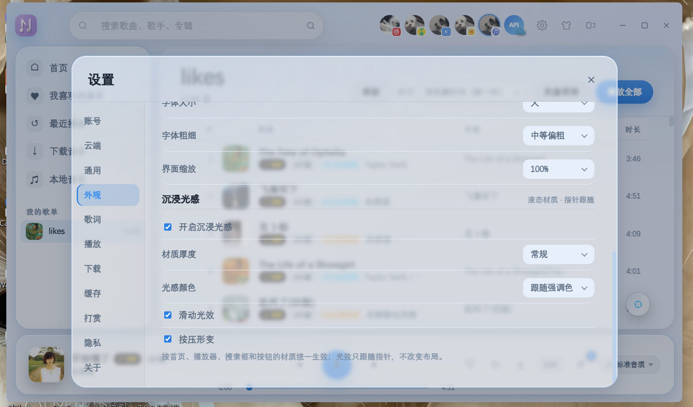
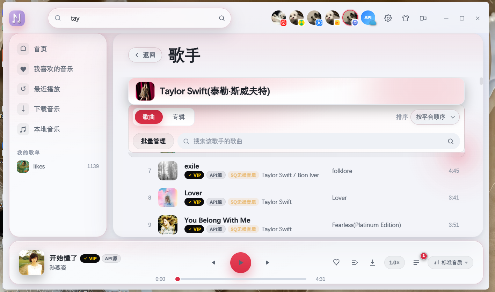
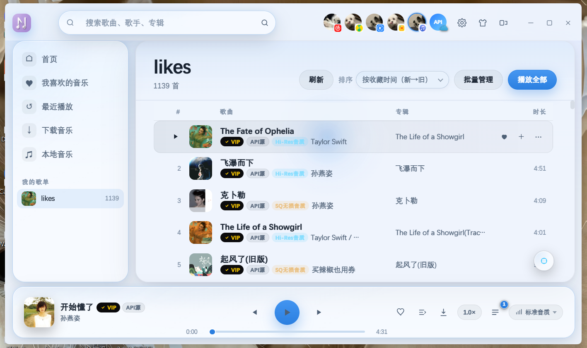
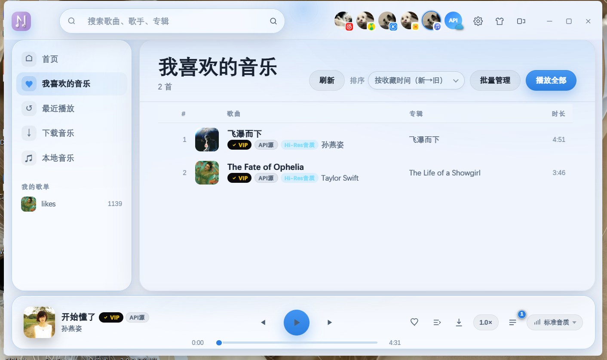

# Novae

> **发现新声音** · 一个为 Windows 打造的多平台桌面音乐播放器

Novae 是一个用 **Wails（Go + WebView2）** 构建的桌面音乐客户端。它把华为音乐、QQ 音乐、网易云音乐、酷狗音乐、酷我音乐放在同一个界面里，支持多平台账号并存、随时切换；也可以不登录平台，只接一个自建或公开的云端音源。

**Windows 10 / 11 x64**

[GitHub 下载](https://github.com/TongWang0808/novae-releases/releases/latest) · [Gitee 下载](https://gitee.com/meiliwang0808/novae-releases/releases/latest)

---

## 下载安装

| 来源 | 地址 |
| --- | --- |
| GitHub Release | https://github.com/TongWang0808/novae-releases/releases/latest |
| Gitee Release | https://gitee.com/meiliwang0808/novae-releases/releases/latest |

下载 `novae.exe` 后直接运行即可，不需要安装器。首次启动需要系统具备 WebView2 运行时（Windows 11 已内置，Windows 10 通常也已安装）。

> 内置更新支持 GitHub / Gitee 双源。设置页「关于」可以检查更新；检测到新版本会显示红点和更新说明，但不会自动下载，用户可以选择立即下载或继续使用当前版本。

---

## 界面预览

以下截图直接来自 Novae 实际界面。

| 沉浸播放页面 | 沉浸光感与按压形变 |
| --- | --- |
|  |  |

| 多种外观选择 | 歌手大卡片 |
| --- | --- |
|  |  |

| 歌手卡片吸顶和歌曲展示 | 歌手专辑 |
| --- | --- |
|  |  |

| 加入群聊反馈 | 联想搜索与历史记录 |
| --- | --- |
|  |  |

| 平台歌单 | 平台账户卡片 |
| --- | --- |
|  |  |

| 账号管理页面 | 我喜欢的音乐 |
| --- | --- |
|  |  |

---

## 核心功能

### 多平台账号

- 华为音乐、QQ 音乐、网易云音乐、酷狗音乐、酷我音乐可以同时登录、随时切换。
- 平台账号、云端接口都可以设为默认音源；平台返回试听片段时，可用辅助音源补全。
- 登录态检查会实际向平台询问是否有效，失效时给出原因并支持重新授权。
- Cookie 使用 Windows DPAPI 加密保存在本机，不保存账号密码，也不模拟登录协议。

### 曲库与播放

- 我的歌单、收藏、自建歌单、榜单歌单自动整理，曲目渐进加载。
- 最近播放、下载音乐、本地音乐支持「播放全部」、单曲播放和批量管理。
- 播放队列支持顺序、列表循环、单曲循环、随机、拖动排序、清空。
- 播放过渡支持关闭、淡入淡出、交叉淡化、无缝播放；倍速 0.5×–2.0×；定时关闭。
- 歌曲右键菜单和「更多」支持歌曲详情、下一首播放、加入队列、下载、收藏。

### 搜索、歌手与专辑

- 按当前平台搜索，结果只显示该平台的数据，不混入其它平台条目。
- 搜索页包含歌手、专辑、歌曲三级结果；歌手 / 专辑卡片采用「外层背景板 + 独立卡片」结构。
- 歌手页提供歌曲、专辑、排序、批量管理和简介展开；简介支持点击或双击卡片展开 / 收起。
- 搜索页的歌手 / 专辑卡片和背景板均支持鼠标滑动光效。

### 歌词与音质

- 全屏沉浸歌词页：逐行高亮、点击歌词跳转、封面模糊背景。
- 支持平台翻译歌词、歌词对齐方式、字号、行距调整。
- 音质档位按平台真实档位列示，并在取流后实测容器头和码率，低于所选档位时如实降标。
- 播放失败会先降一档重试，仍失败再按「播放失败或无音源时自动下一首」处理。

### 外观与交互

- 12 套主题 + 跟随系统：午夜、曜石、极地、森语、深海、暮紫、余烬、白昼、纸张、薄荷、樱花、晴空。
- 界面字体、字号、字重、界面缩放独立设置；默认主题为「晴空」，默认字体为等线。
- 沉浸光感：侧栏、顶栏、主内容、播放器、播放队列、搜索页、设置浮层统一为玻璃质感表面。
- 鼠标滑动光效：按钮、卡片、列表行和页面大表面会出现跟随指针的前后双圈扫光。
- 统一按钮按压反馈：缩幅 96%，右下按钮向下形变；可在设置中整体关闭。
- 迷你播放器、托盘、关闭到托盘、原生标题栏明暗联动。

### 下载与云端

- 单曲下载、批量筛选下载（全部 / 仅 VIP / 仅免费），可选音质和目录。
- 试听片段拒绝下载，不会把 30 秒片段保存成完整歌曲。
- 云端音源支持多条接口、测试连接、设为默认音源，也可只作为平台无会员时的兜底。
- 接口地址、UID 保存在本机；远程 HTTP 携带 Cookie 会被拒绝。

### 应用更新

- 版本号位置提供检查更新入口，启动后也会自动检查。
- 新版本显示红点、版本号、更新说明和下载入口，不强制更新、不自动下载。
- 更新源支持 GitHub / Gitee 切换；GitHub 不稳定时可以改用 Gitee 检查和下载。
- 设置页「关于」新增下载统计：进入页面自动刷新，也可手动刷新。GitHub 会汇总全部可读取版本；Gitee 公开接口不返回下载次数，显示为「—」，不会伪造数据。

---

## 1.3.3 更新摘要

本版基于 1.3.2，重点修复搜索光效层级、播放过渡可靠性、API 偶发取流失败与确认框视觉；1.3.2 的搜索一致性、喜欢 / 本地音乐操作和设置页下拉控件继续保留。

搜索光效：鼠标进入「最近搜索 / 联想搜索」浮层后，胶囊搜索框停止跟随光效，不再残留左右滑动光斑；浮层记录行、标题条和「歌曲 / 专辑 / 时长」吸顶表头各自接光，历史记录与表头不再挡住光斑；顶栏在浮层 hover 时切为静态背景，避免父层拖尾透过半透明搜索框。

播放过渡：淡入淡出 / 交叉淡化 / 无缝播放改为提前预取下一首并维护备用播放通道；交叉淡化只消费已预取流，无缝播放在结尾前以静音预播下一首，减少曲间空档；切模式、暂停、手动切歌时统一清理预取通道。

API 与播放：上游风控、超时、5xx/429 等瞬时失败不再直接提示「API 源没有该歌曲」，用户点歌时自动重试一次；同一 BaseURL 的默认 API 与辅助音源不再重复请求；修复歌曲条左侧播放按钮按下时整行缩放导致按钮右移、松手点不到的问题。

移除与弹框：从最近播放移除增加二次确认；从下载记录移除保留确认与「同时删除本地文件」勾选；确认框 / 输入框改为歌曲条「更多」菜单同款玻璃背景，宽度 560 / 480 / 520px，标题 / 正文 / 说明 14 / 12 / 11px，遮罩透明、背景可见。

设置与版本：沉浸光感新增「光效强度（柔和 / 标准 / 浓郁）」和「光效大小（小 / 标准 / 大）」；应用内版本号更新为 1.3.3，Windows 文件属性中的文件版本 / 产品版本同步为 1.3.3.0。
---

## 隐私与安全

- 不保存平台账号密码，不模拟登录接口；Cookie 只保存在本机，并用 Windows DPAPI 加密。
- 所有平台的 Cookie、昵称、头像与会员信息在 `%APPDATA%\Novae\accounts.json`；华为登录凭据单独加密。
- 下载目录、播放记录和缓存都在本机；启用歌词翻译时，歌词文本会发送给第三方翻译服务（不含 Cookie）。
- 本项目不内置任何音源、账号或会员凭据；云端 / 本机 API 由使用者自行部署并承担相应责任。

---

## 系统要求

- Windows 10 / 11 x64
- WebView2 Runtime
- 建议 4GB 以上内存

## 说明

本项目为独立实现，与华为、腾讯、网易、酷狗、酷我及其关联公司没有隶属、合作或代理关系；各平台名称、会员名称与相关权利归对应公司所有。本项目不破解 DRM，也不会把试听片段当作完整歌曲下载。

---

## 致谢

界面组织与交互细节参考过：

- [沐语](https://wutuapp.com/)
- [听澜 · Tinglan](https://github.com/talongao/tinglan)
- [Melotopia](https://melotopia.chenlvin.cc/)

以及 [Wails](https://wails.io/)、[NeteaseCloudMusicApi](https://www.npmjs.com/package/NeteaseCloudMusicApi) 与各平台公开接口的社区整理。

## 许可

[MIT](https://github.com/TongWang0808/novae-releases/blob/main/LICENSE)
