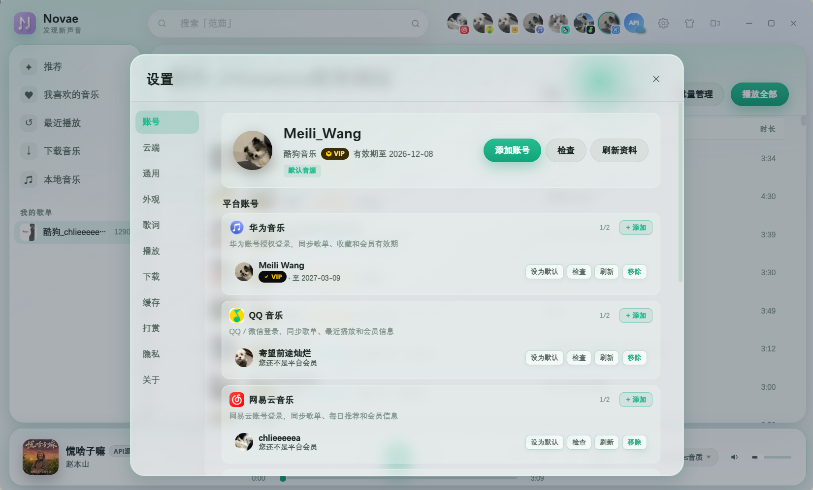
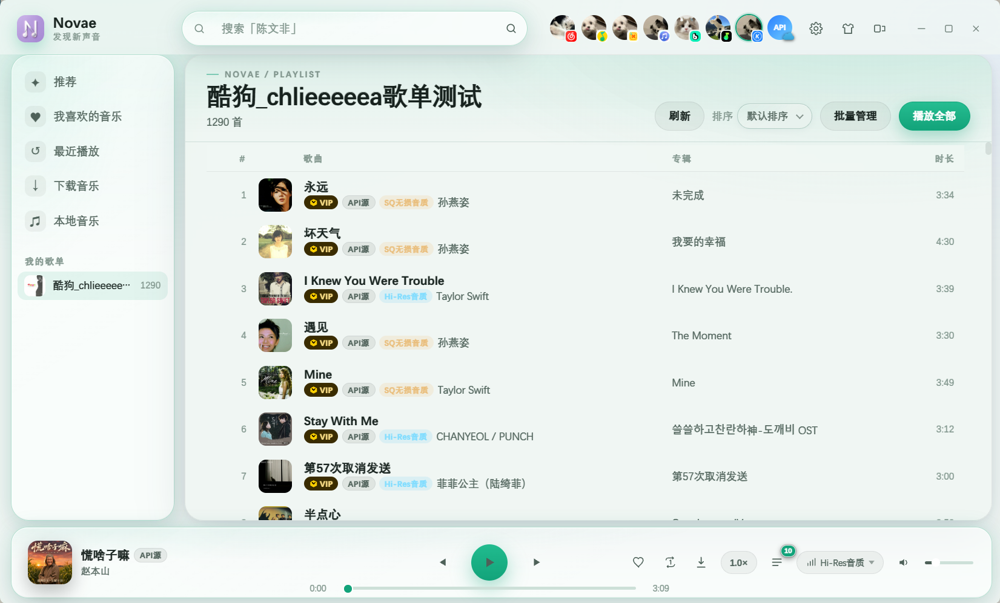
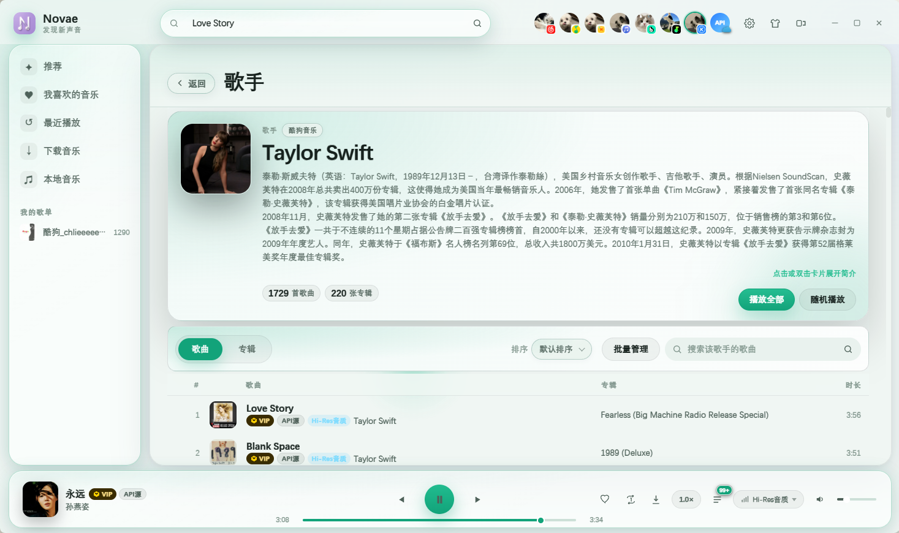
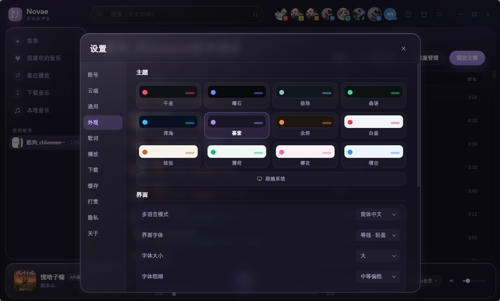
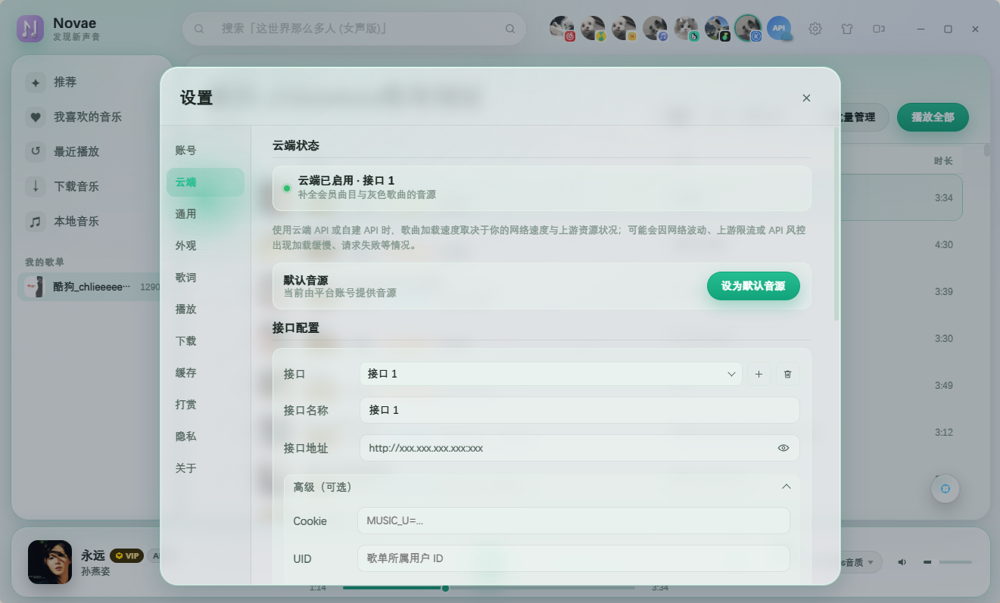
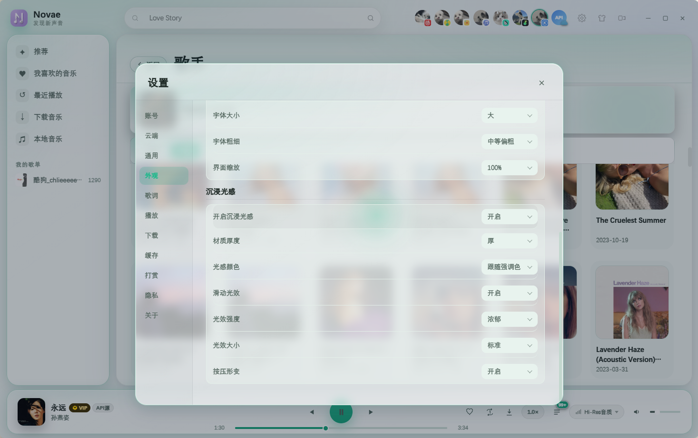
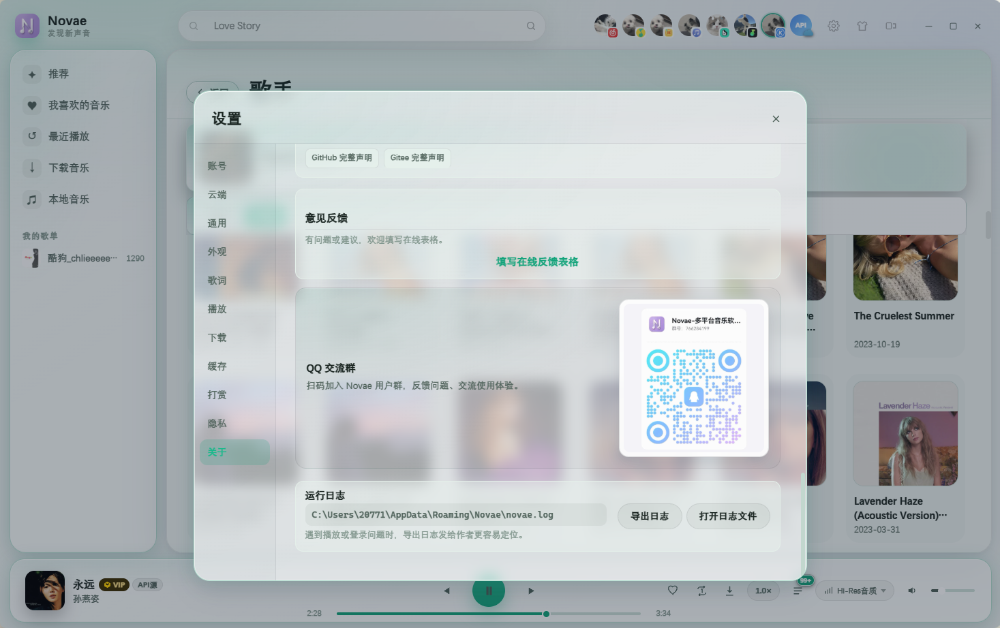

# Novae

**把七个音乐平台，放进同一个 Windows 播放器。**

Novae 是基于 **Wails v2（Go + WebView2）** 构建的桌面音乐客户端。华为音乐、QQ 音乐、网易云音乐、酷狗音乐、酷我音乐、汽水音乐与波点音乐可以同时登录、随时切换；也可以不登录任何平台，只接一个自建或公开的云端音源。

[](https://github.com/TongWang0808/novae-releases/releases/latest)
[](https://github.com/TongWang0808/novae-releases/releases/tag/v1.4.5)
[](LICENSE)

[下载最新版](https://github.com/TongWang0808/novae-releases/releases/latest) · [Gitee 镜像](https://gitee.com/meiliwang0808/novae-releases/releases/latest) · [官网](https://tongwang0808.github.io/novae-releases/) · [更新清单](https://github.com/TongWang0808/novae-releases/blob/main/latest.json)

> 本项目为独立实现，与华为、腾讯、网易、酷狗、酷我、抖音/汽水及其关联公司没有隶属、合作或代理关系。各平台名称、会员名称与相关权利归对应公司所有。Novae 不内置音源、账号或会员凭据，不破解 DRM。

## 1.4.5 更新摘要

这是一个以 **七平台搜索口径统一、启动隐私弹窗与退出确认返工** 为主的维护版；安装包与便携包继续双包分发。

- **搜索统一匿名**：华为、网易云、QQ、酷狗、酷我、汽水、波点七家搜索全部走匿名通道，登录账号不再改变搜索结果；游客、账号、API 默认音源三种状态下都保留完整七家平台。
- **计数口径对齐**：平台标签按实际已加载、去重后的歌曲数显示；歌手页头部与列表使用同一份数量，不再出现头部和列表对不上。
- **翻页容错**：首屏已返回的平台，后续翻页遇到酷狗 502、酷我 403 或超时时不再整家标成「不可用」；对 403 / 408 / 429 / 5xx / 超时做短退避重试。
- **启动隐私弹窗**：固定 960×600，与设置页同画幅同步缩放；完整声明展开后正文独立滚动，头部与底栏固定。
- **字体与玻璃**：弹窗改用设置页同一套字体，去掉 650 字重、额外字距与 `text-shadow`；隐私弹窗和退出确认统一为 96% 主题底 + `blur(28px)` 半透明玻璃。
- **移除手动开关**：设置页隐私板块不再提供「启动时显示隐私提示」开关和「立即显示启动弹窗」按钮；启动提示恢复首次使用、版本更新必弹，其余按天提示。
- **双包分发**：`Novae-1.4.5-Setup.exe` 免管理员权限、可自选安装目录与快捷方式；`Novae-1.4.5-Portable.exe` 单文件运行，继续保留原地替换与 `.bak` 回滚。

1.4.4 的桌面布局、本地音乐、本地喜欢、云端解灰、平台账号持久化与歌词翻译修正全部保留，可查看 [v1.4.4 发布说明](https://github.com/TongWang0808/novae-releases/releases/tag/v1.4.4)。

## 界面

<table>
<tr>
<td width="50%"><br><sub>推荐页与音乐盲盒</sub></td>
<td width="50%"><br><sub>七大平台，一个账号中心</sub></td>
</tr>
<tr>
<td><br><sub>同步平台歌单</sub></td>
<td><br><sub>搜索联想与历史搜索</sub></td>
</tr>
<tr>
<td><br><sub>搜索结果，一览无余</sub></td>
<td><br><sub>歌手简介大卡片</sub></td>
</tr>
<tr>
<td><br><sub>你的外观，由你来定</sub></td>
<td><br><sub>大屏播放，沉浸其中</sub></td>
</tr>
<tr>
<td><br><sub>不仅平台，API 也能兜底</sub></td>
<td><br><sub>沉浸光感，按压形变</sub></td>
</tr>
<tr>
<td><br><sub>专辑卡片，尽收眼底</sub></td>
<td><br><sub>反馈 Q 群，集思广益</sub></td>
</tr>
</table>

## 七个平台，一个账号中心

| 平台 | 登录入口 | 主要能力 |
| --- | --- | --- |
| QQ 音乐 | 网页登录 / QQ / 微信 | 账号、歌单、喜欢、最近播放、搜索、播放、歌词 |
| 酷狗音乐 | 扫码 | 账号、歌单、喜欢、最近播放、搜索、播放、歌词 |
| 酷我音乐 | 网页登录 | 账号、喜欢、歌单、搜索、播放、歌词 |
| 网易云音乐 | 扫码 / 手机号 | 账号、歌单、喜欢、搜索、播放、歌词 |
| 华为音乐 | 网页登录 | 账号、歌单、喜欢、搜索、播放、歌词 |
| 汽水音乐 | 扫码（主）/ 手机号验证码（备用） | 账号、会员、歌单、搜索、播放、歌词、歌手、最近播放 |
| 波点音乐 | 扫码 | 账号、会员、歌单、搜索、播放、歌词、歌手、最近播放 |

汽水 / 波点使用内置客户端，不依赖外部音乐 API；登录会话、播放凭据与签名配置只保存在本机。

## 核心能力

- **统一播放**：七个平台共用一个播放器、队列、歌词页、中控栏与音量控制。
- **最近播放归属**：按实际开播的默认音源归属，预加载、续播、切音质不重复；QQ / 酷狗 / 网易云异步回写官方历史。
- **播放队列**：完整列表 + 5 行可视区 + 右侧滚动条；沉浸模式使用 90% `--bg-elevated` 实底。
- **汽水会员整曲**：SodaM signer / `QISHUI_SIGNER` 签名，CENC MP4 解密与本地代理；完整流优先，试听兜底。
- **波点会员**：会员标识与到期时间、官方最近播放读取与回写、歌单 / 喜欢 / 搜索 / 歌词。
- **搜索与推荐**：搜索联想、历史搜索、歌曲 / 歌手 / 专辑三级结果；每日专辑、音乐盲盒、今日精选、本周热听。
- **歌单同步**：平台歌单收藏、加入 / 移出已有歌单、加入前重复检测。
- **云端兜底**：平台取流失败可切云端 API；API 不可用回退平台。
- **外观与缩放**：12 套主题、玻璃表面、沉浸光感、指针光斑、统一按压形变；五档界面缩放全页适配。
- **隐私与安全**：接口地址默认完整脱敏；已配置地址只读，点击眼睛按钮才显示真实地址并允许编辑。
- **下载与更新**：单曲 / 批量下载、音质选择、下载目录、文件缺失闭环；应用内读取双端更新清单。

## 版本日志

### 1.4.5（2026-11-28）

- 七平台搜索全部固定走匿名通道：华为、网易云、QQ、酷狗、酷我、汽水、波点在登录态与游客态下不再返回两套结果；搜索栏在游客、账号、API 默认音源三种状态下都保留完整七家。
- 搜索计数改为按实际已加载、去重后的歌曲数计算，平台标签不再显示上游上报总数；歌手页头部歌曲数、专辑数同步改用实际列表数量，修复「196 首 / 128 首」对不上。
- 首屏已返回的平台，后续翻页遇到酷狗末尾 502、酷我 403 或超时时不再把整家平台标成「不可用」；搜索请求对 403 / 408 / 429 / 5xx / 超时做短退避重试，401 / 404 不重试。
- 启动隐私弹窗固定 960×600，与设置页同画幅并跟随同一个缩放变量；「查看完整隐私声明」展开后正文区独立滚动，头部与底栏固定。
- 弹窗字体改用设置页同一套 `--ui-font-family`，去掉 650 中间字重、标题额外字距和 `text-shadow`，修复字体发虚、重影。
- 启动隐私弹窗与退出确认统一为半透明玻璃：96% 主题底、`blur(28px) saturate(1.18)`、半透明描边与内高光；二维码 132px，窄屏 120px。
- 移除设置页隐私板块的「启动时显示隐私提示」开关与「立即显示启动弹窗」按钮；启动提示恢复首次使用、版本更新必弹，其余按天提示，只有「今日不再弹出」跳过当天。
- 版本元数据统一为 `1.4.5` / `1.4.5.0`；安装包与便携包双包分发，继续保留安装版静默升级与便携版原地替换 `.bak` 回滚。
- `go test -count=1 ./...` 全部通过；`node --check frontend/dist/app.js` 通过；Wails `windows/amd64` 构建、UPX 校验、静默安装/卸载往返验证均通过。

### 1.4.4（2026-11-27）

- 桌面布局按新的工作区参考重做：侧栏、顶栏、内容区与播放器统一基线；125% / 150% 下推荐页改为自适应横排，今日精选五张方形封面并排，本周热听独立成卡并内部滚动；账号过多时顶部账号条可横向滚动。
- 推荐页专辑大标题、“音乐盲盒”、栏目标题和日期数字恢复 `Noto Serif SC` 衬线字体；下拉菜单才跟随界面字体。字号统一为标题、正文、辅助文字三档，整体放大约 8%。
- 重新选择本地检索目录时清除旧隐藏记录，新增“已移除 N 首 / 恢复”；扫描扩展名补充 `.opus/.m4b/.mp4`；“打开检索文件夹”改为独立窗口。
- 本地音频播放通过云端识别补全歌名、歌手、专辑、封面与歌词；`孙燕姿 - 我不难过` 实测显示“我不难过 / 孙燕姿 / 未完成”、封面与 5:20 时长。
- 本地歌曲可以点红心写入 `api-likes.json`，重启后仍能恢复；“我喜欢的音乐”支持平台喜欢 + 本地喜欢合并，平台账号模式显示“含本地 N 首”；实机 QQ 账号下显示 1145 首 · 含本地 1 首。
- 本地页批量栏和右键菜单去掉“加入歌单”；批量栏保留“加入到喜欢”，本地歌曲只写本地喜欢。
- 30 秒试听自动救援完整音源；新增云端 `/song/url/match` 解灰，覆盖 API 缺歌、平台拒绝与会员档位不足；APE/DSD 自动降档；汽水音质档位修正为 `standard/hq`。
- 网易云改为内置官方接口直连，不再依赖自建云端 API；酷狗设备 GUID 与完整 Cookie 持久化；汽水签名器随包内置；波点补会员徽标解析。
- 搜索页只保留华为、网易云、QQ、酷狗、酷我、汽水、波点 7 个平台，默认华为，不再显示“API 曲库”；搜索“漩涡”默认华为返回 161 首。
- 歌词翻译改为有道直连，修复翻译按钮点一次后永久失效的问题；`Opalite` 实测中英对照正常。
- 云端地址输入框始终可编辑，聚焦时展开并全选；迷你播放器进入/退出顺序修复，启动提示未关闭时禁止进入迷你模式。
- 安装包与便携包继续双包分发：`Novae-1.4.4-Setup.exe`（27,426,798 字节）与 `Novae-1.4.4-Portable.exe`（62,904,320 字节），文件版本 / 产品版本均为 `1.4.4.0`。
- `go test -count=1 ./...` 通过；`node --check` 与 `go vet` 通过；4 种窗口尺寸 × 5 档缩放 × 4 档字号共 1200 项布局回归全部通过。

### 1.4.3（2026-11-26）

- 取流失败新增归因与统一文案：平台明确拒绝 + 无可用会员 + 未接入云端 API 源时，提示“该账户目前没有平台会员且未接入 API 源，请获取平台会员或接入 API 源后尝试”；本机端口、请求参数与平台返回码不再出现在用户提示里。
- 同一规则覆盖 QQ、酷狗、酷我、网易云、汽水、波点、华为的取流链路，避免“未开会员却提示重新登录”。
- 侧栏「我的歌单」改为唯一滚动区：推荐、本地音乐等五个固定模块不再随歌单滚动；滚动条限制在歌单区内，不再在面板顶部 / 底部溢出。
- 歌单列表新增上下渐隐，滚动时滚动条浮现、停手自动隐藏。
- 歌词页展开 / 收起去掉全屏深色遮罩与主界面隐藏，退全屏的窗口尺寸变化改在卷帘仍覆盖时完成，进出全屏不再黑屏闪一下。
- 迷你播放器修复深色主题下的白玻璃与错位：玻璃底色跟随主题，重排为封面 / 曲名歌手 / 走带三列、歌词独立一行、进度条贴底，变矮变窄自动进紧凑档。
- 首次提供安装包 `Novae-1.4.3-Setup.exe`（免 UAC，安装到 `%LOCALAPPDATA%\Programs\Novae`，可勾选开始菜单与桌面快捷方式，卸载保留 `%APPDATA%\Novae` 用户数据）与便携包 `Novae-1.4.3-Portable.exe`。
- 应用内更新分流：安装版升级下载安装包静默装回原目录，卸载项、快捷方式与版本记录一并刷新；便携版继续原地替换 exe，保留 `.bak` 回滚。便携资产命名为 `Novae-1.4.3-Portable.exe`，文件名带版本号，便于区分新旧包。
- 内置更新默认走 Gitee 源（国内下载更快），检查失败可在「设置 → 关于」切回 GitHub。主包与 internal 测试通过；正式包文件版本 `1.4.3.0`。

### 1.4.2（2026-11-25）

- 网易云账号资料与会员状态改为直连官方接口，不再依赖本机 `localhost:3000` 云端 API；连接失败不再误报登录失效。
- 网络失败、超时与临时 `403` 只显示“暂时无法检查”；仅官方 `301` / `401` 或 Cookie 缺失才要求重新登录。
- 网络错误隐藏带 `MUSIC_U` 的请求 URL，避免 Cookie 写入日志。
- 设置页改为 940 × 600 完整构图，按窗口可用宽高整体缩放；下拉菜单限制在设置面板内。
- 隐私弹窗同步 940 × 600，QQ 群二维码 220px；关闭确认按 420 × 400 设计上限缩放。
- 每次关闭窗口都弹确认，移除“记住选择、下次不再询问”；设置文案只决定默认去向。
- 主包与 internal 测试通过；正式包文件版本 `1.4.2.0`。

### 1.4.1（2026-11-25）

- 会员状态改为只认各平台官方当前有效权益；历史 VIP 标记、旧 Cookie、失败或空响应不再覆盖已核实结果。
- 修正华为音乐把 `hadVIPs.vipFlag` 当成当前会员的问题，现按有效 `subInfos` 判断。
- 修正酷狗会员字段递归串扰，改为账号根字段优先；酷我补上官方会员查询并移除提前返回。
- QQ / 微信统一用户 ID 与音乐票据识别，修复微信已登录却提示 Cookie 不完整。
- 搜索联想改为歌曲封面、圆形歌手头像与专辑封面，歌手头像按平台补取。
- 准星图标跟随 12 套主题强调色；歌词展开 / 收起改为对称 420ms 过渡，修复页面颤抖与播放条残影。
- “本周热听”说明紧跟标题；启动提示支持“今日不再弹出”。
- 新增 `crash.log` 与运行标记，记录未处理 panic 与上次异常退出信息。
- 8 个现有会话的会员状态经官方接口核验；主包与 internal 测试通过，正式包文件版本 `1.4.1.0`。

### 1.4.0（2026-11-25）

- QQ 音乐的 QQ、微信扫码改用官方音乐 OAuth 独立入口；修复扫码成功后 Novae 一直等待、微信提示 Cookie 不完整。
- 微信账号读取官方资料头像，不再显示默认企鹅图，也不会被兜底头像覆盖。
- 华为、QQ、微信、网易云、酷我登录完成后自动关闭官方窗口；酷狗、汽水、波点扫码后自动收起登录面板。
- 修复连续登录时回调资源泄漏导致主程序退出的问题；5000 次窗口枚举压力测试通过。
- 今日精选歌曲条改用条目内部右侧播放按钮，尺寸对齐“本周热听”，时长显示在按钮左侧。
- 沉浸光感五档厚度、模糊与按压参数重新校准，档位名称统一为超薄 / 薄 / 常规 / 厚 / 超厚。
- 七平台、八份登录会话实机验证通过，登录完成后无残留官方窗口。

### 1.3.9（2026-11-24）

- 新增汽水音乐内置客户端：扫码登录、2046 官方二次验证宿主、手机号验证码备用入口、账号 ID 回读校验。
- 新增汽水会员整曲链路：PC 端 `track_v2` 签名、CENC MP4 解密、本地媒体代理、完整流优先与试听兜底。
- 新增波点音乐内置客户端：扫码登录、账号资料、会员到期、歌单、搜索、歌词、歌手介绍、最近播放。
- 最近播放改为按实际开播的默认音源归属；QQ / 酷狗 / 网易云异步回写官方历史，移除排序控件。
- 播放队列取消分页与下拉框，固定 5 行可视区 + 右侧滚动条；沉浸队列改为 90% 实底。
- 账号详情改为“登录入口”，按平台显示扫码 / 账号 / 授权入口；账号页补齐用途说明与统一 Hero 表面。
- 设置页接口地址默认脱敏并只读，眼睛按钮切换显示与编辑；账号卡接口地址同步脱敏。
- 汽水 / 波点会员字标缩放到 10px 高、32px 宽；账号默认音源卡改半透明玻璃。
- 软件内「设置 → 关于 → 致谢与开源许可」同步到 2026-11-24 / 1.3.9：补入 SodaM、mygo-music-qishui、bowen_music 与 11 个新增 Go 模块，模块清单从 20 个更新为 31 个。
- 全页面 90% / 100% / 110% / 125% / 150% 五档适配；推荐页按逻辑宽度重排。
- 播放接口可用性探测、播放解析回退、最近播放元数据补全、缓存键与歌曲信息整理。

### 1.3.8（2026-11-23）

- 播放队列徽标全档完整，面板贴住中控栏。
- 搜索推荐词点击搜索、点输入框恢复自由输入。
- 推荐页按逻辑宽度五档重排。

### 1.3.7（2026-11-21）

- 统一账号中心与多登录方式面板；补齐汽水 / 波点会员与最近播放。
- 优化多缩放下的账号页、设置页与中控栏排版。

## 下载与校验

- 版本：**1.4.5**（Windows 文件版本 / 产品版本 `1.4.5.0`）
- 安装包：`Novae-1.4.5-Setup.exe`　`60,608,499` 字节
- 便携包：`Novae-1.4.5-Portable.exe`　`60,003,328` 字节
- SHA-256（安装包）：`0053FA6E7437F1688228170F7BDEBBDE6935CB1CFE0BD7018222A5D55AD9825A`
- SHA-256（便携包）：`FCEB267196726AE704D165D1D40D1C23EB5287210F23D1E422A3A0103AD72824`
- GitHub Releases：<https://github.com/TongWang0808/novae-releases/releases/tag/v1.4.5>
- Gitee Releases：<https://gitee.com/meiliwang0808/novae-releases/releases/tag/v1.4.5>

```text
0053FA6E7437F1688228170F7BDEBBDE6935CB1CFE0BD7018222A5D55AD9825A  Novae-1.4.5-Setup.exe
FCEB267196726AE704D165D1D40D1C23EB5287210F23D1E422A3A0103AD72824  Novae-1.4.5-Portable.exe
```

## 安装

**安装包（推荐）**

1. 下载并运行 `Novae-1.4.5-Setup.exe`，安装到当前用户目录 `%LOCALAPPDATA%\Programs\Novae`，不需要管理员权限。
2. 安装过程可勾选「创建开始菜单快捷方式」（默认勾选）与「创建桌面快捷方式」（默认不勾选）；卸载时两者一并清理。
3. 卸载只删除程序目录，`%APPDATA%\Novae` 下的账号、歌单、最近播放与下载记录保留。

**便携包**

1. 下载 `Novae-1.4.5-Portable.exe`。
2. 直接运行，或替换旧版 `Novae.exe`，用户数据、登录态、歌单与下载记录保留在原有 WebView2 用户目录。

**通用**

4. 首次启动如遇 Windows SmartScreen，选择“更多信息 → 仍要运行”。
5. 汽水会员整曲需本机 SodaM signer 或设置 `QISHUI_SIGNER_URL` / `QISHUI_SIGNER_TOKEN`；未配置时自动回退公开流或试听。
6. 高缩放档在“设置 → 外观 → 界面缩放”切换；推荐页与账号页按逻辑宽度重排，设置页与弹窗按完整构图整体缩放。

## 第三方与许可

Novae 本体采用 MIT License，见 [LICENSE](LICENSE)。内置 sidecar、Go 模块、界面参考与接口参考的完整清单见 [THIRD-PARTY-NOTICES.md](THIRD-PARTY-NOTICES.md)。

- `assets/kugou-api.exe` 来自 KuGouMusicApi（MIT）。
- 汽水登录 / 签名 / 播放链路参考 SodaM、mygo-music-qishui 等公开实现；未随包分发其源码。
- 波点会员与最近播放协议参考 bowen_music 等公开实现；未随包分发其源码。
- 界面与液态材质采用独立设计，并参考听澜、Melotopia 与 MyGo；仅参考视觉与交互，未复制代码。

## 致谢

感谢所有在公开仓库、Issue、群聊与实测中提供平台协议、接口字段、登录流程和播放链路线索的开发者。

反馈与交流：见应用内“反馈 Q 群”页面。
