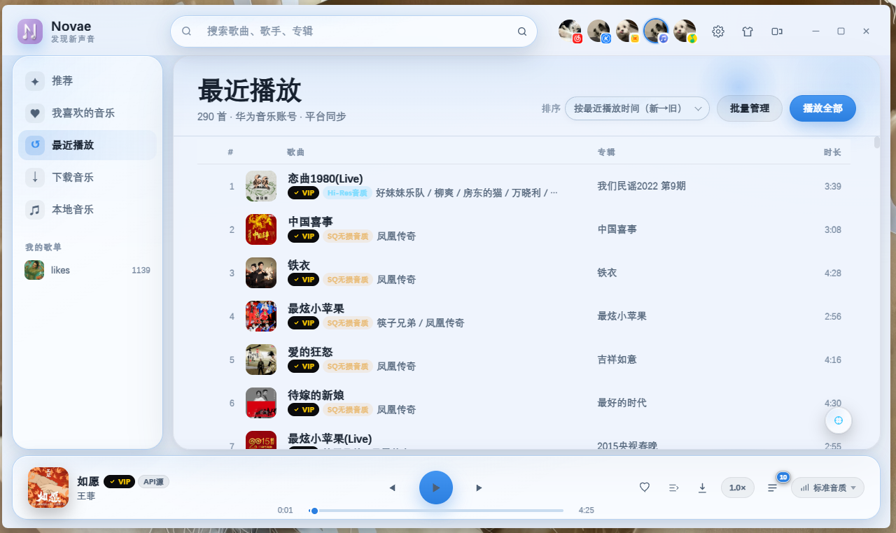
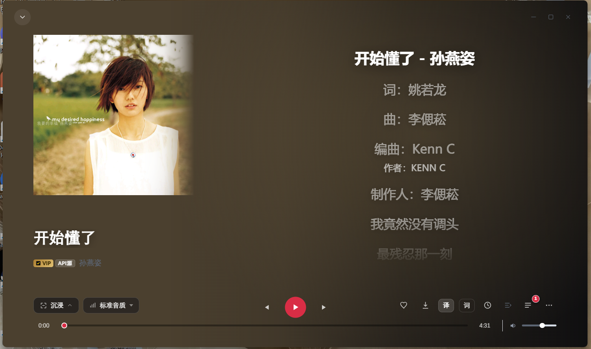
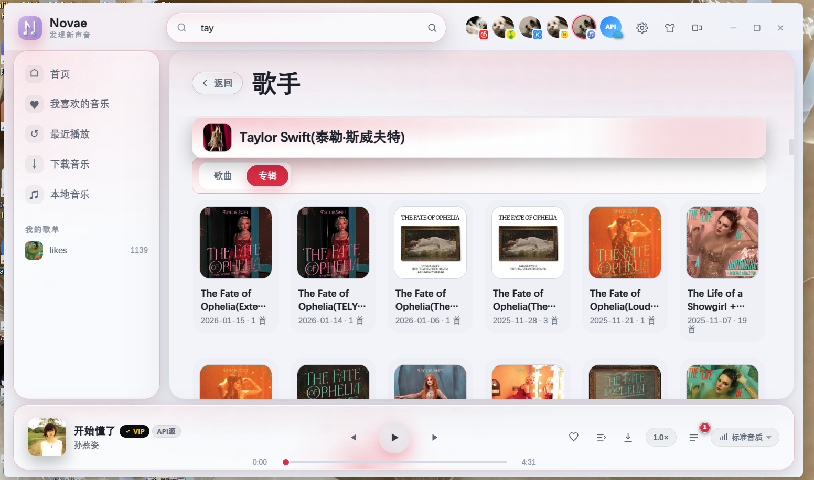
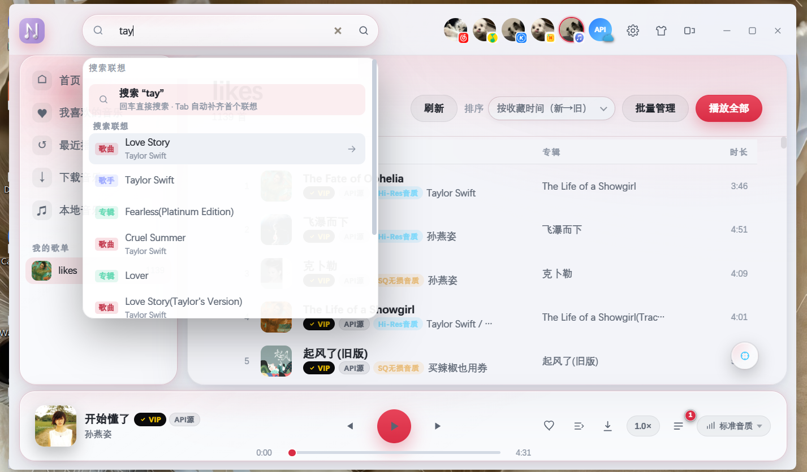
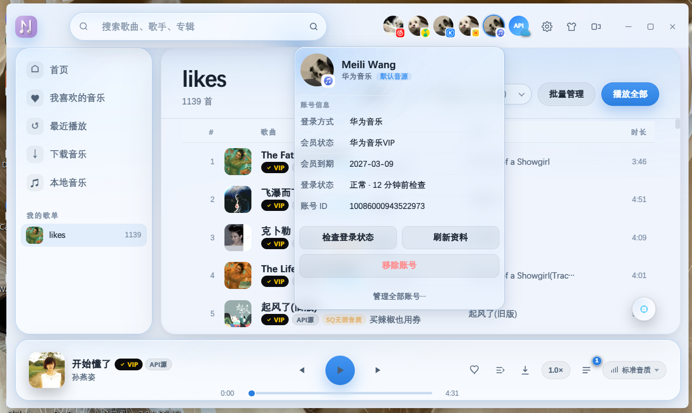

# Novae

> **发现新声音** · 一个为 Windows 打造的多平台桌面音乐播放器

Novae 是一个用 **Wails（Go + WebView2）** 构建的桌面音乐客户端。它把华为音乐、QQ 音乐、网易云音乐、酷狗音乐、酷我音乐放在同一个界面里，支持多平台账号并存、随时切换；也可以不登录平台，只接一个自建或公开的云端音源。

**Windows 10 / 11 x64**

[GitHub 下载](https://github.com/TongWang0808/novae-releases/releases/latest) · [Gitee 下载](https://gitee.com/meiliwang0808/novae-releases/releases/latest)

---

## 下载安装

| 来源 | 地址 |
| --- | --- |
| GitHub Release | https://github.com/TongWang0808/novae-releases/releases/latest |
| Gitee Release | https://gitee.com/meiliwang0808/novae-releases/releases/latest |

下载 `novae.exe` 后直接运行即可，不需要安装器。首次启动需要系统具备 WebView2 运行时（Windows 11 已内置，Windows 10 通常也已安装）。

> 内置更新支持 GitHub / Gitee 双源。设置页「关于」可以检查更新；检测到新版本会显示红点和更新说明，但不会自动下载，用户可以选择立即下载或继续使用当前版本。

---

## 界面预览

以下截图直接来自 Novae 实际界面。

| 推荐页 · 等你探索 |
| --- |
|  |

| 最近播放 · 平台同步 |
| --- |
|  |

| 沉浸播放页面 |
| --- |
|  |

| 沉浸光感与按压形变 |
| --- |
|  |

| 多种外观选择 |
| --- |
|  |

| 歌手大卡片 |
| --- |
|  |

| 歌手卡片吸顶和歌曲展示 |
| --- |
|  |

| 歌手专辑 |
| --- |
|  |

| 加入群聊反馈 |
| --- |
|  |

| 联想搜索与历史记录 |
| --- |
|  |

| 平台歌单 |
| --- |
|  |

| 平台账户卡片 |
| --- |
|  |

| 账号管理页面 |
| --- |
|  |

| 我喜欢的音乐 |
| --- |
|  |

---

## 核心功能

### 多平台账号

- 华为音乐、QQ 音乐、网易云音乐、酷狗音乐、酷我音乐可以同时登录、随时切换。
- 平台账号、云端接口都可以设为默认音源；平台返回试听片段时，可用辅助音源补全。
- 登录态检查会实际向平台询问是否有效，失效时给出原因并支持重新授权。
- Cookie 使用 Windows DPAPI 加密保存在本机，不保存账号密码，也不模拟登录协议。

### 推荐与发现

- 「推荐页」是默认启动页，也可以在设置 → 启动页中重新选择。
- 推荐页顶部的每日专辑大卡显示当天日期、封面拼贴和专辑信息，可直接「从头播放」或「查看专辑」。
- 「音乐盲盒」点击骰子按钮会摇动并随机播放一首歌；游客模式随机推荐，接入 API 后按本机 API 播放记录推荐，没有记录时随机，登录平台后按该平台最近播放与推荐接口生成内容。
- 「今日精选」展示 5 张方形卡片；「本周热听」自动跟随当前平台，登录平台账号时读取该平台真实热歌榜前 10 首，游客或 API 源随机推荐 10 首；列表固定 5 行，10 首可在面板内滚动。
- 推荐来源集中在页头的来源选择处，游客、API 源和具体平台账号各有独立推荐逻辑；本周热听标题只显示「10 首 · 平台名」或「10 首 · 随机推荐」，不额外显示平台 Logo。

### 曲库与播放

- 「我喜欢的音乐」与「我的歌单」自动整理；平台返回的收藏歌单、自建歌单和榜单歌单统一列在侧栏，曲目渐进加载。
- 最近播放、下载音乐、本地音乐支持「播放全部」、单曲播放和批量管理。
- 播放队列支持顺序、列表循环、单曲循环、随机、拖动排序、清空。
- 播放过渡支持关闭、淡入淡出、交叉淡化、无缝播放；倍速 0.5×–2.0×；定时关闭。
- 歌曲右键菜单和「更多」支持歌曲详情、下一首播放、加入队列、下载、加入到喜欢。

### 搜索、歌手与专辑

- 按当前平台搜索，结果只显示该平台的数据，不混入其它平台条目。
- 搜索页包含歌手、专辑、歌曲三级结果；歌手 / 专辑卡片采用「外层背景板 + 独立卡片」结构。
- 歌手页提供歌曲、专辑、排序、批量管理和简介展开；简介支持点击或双击卡片展开 / 收起。
- 搜索页的歌手 / 专辑卡片和背景板均支持鼠标滑动光效。
- 专辑详情右侧抽屉使用加厚蓝玻璃，歌曲表头透明并与背景融合。

### 歌词与音质

- 全屏沉浸歌词页：逐行高亮、点击歌词跳转、封面模糊背景。
- 支持平台翻译歌词、歌词对齐方式、字号、行距调整。
- 音质档位按平台真实档位列示，并在取流后实测容器头和码率，低于所选档位时如实降标。
- 播放失败会先降一档重试，仍失败再按「播放失败或无音源时自动下一首」处理。

### 外观与交互

- 12 套主题 + 跟随系统：午夜、曜石、极地、森语、深海、暮紫、余烬、白昼、纸张、薄荷、樱花、晴空。
- 新用户默认「晴空」主题 + 「等线」字体；界面字体、字号、字重、界面缩放可独立设置。
- 沉浸光感：侧栏、顶栏、主内容、播放器、播放队列、搜索页、设置浮层统一为玻璃质感表面。
- 鼠标滑动光效：按钮、卡片、列表行和页面大表面会出现跟随指针的前后双圈扫光；推荐页专辑大卡、音乐盲盒、今日精选卡和本周热听行均已覆盖。
- 推荐页按 620px 设计基准等比缩放；专辑大卡内部元素跟随卡片宽高计算 `--a-u`，窄卡片下标题、按钮和封面同步收缩，不再依赖固定断点。
- 设置页的分组、账号卡、平台组、云端状态卡、默认音源卡、接口配置卡、自建 API 卡、音质检测卡和反馈卡统一为同一套半透明表面：12px 圆角、细描边，向「自行搭建 API 源」卡片看齐。
- 设置 → 关于页把致谢、第三方依赖和许可证信息合并到同一页，按「随 exe 分发」「外部服务与数据参考」「界面与视觉参考」分组展示，并保留完整声明入口。
- 我喜欢的音乐、最近播放、下载音乐、本地音乐和歌单详情使用与推荐页一致的英文眉题和页头排版。
- 统一按钮按压反馈：缩幅 96%，右下按钮向下形变；可在设置中整体关闭。
- 迷你播放器、托盘、关闭到托盘、原生标题栏明暗联动。

### 下载与云端

- 单曲下载、批量筛选下载（全部 / 仅 VIP / 仅免费），可选音质和目录。
- 试听片段拒绝下载，不会把 30 秒片段保存成完整歌曲。
- 云端音源支持多条接口、测试连接、设为默认音源，也可只作为平台无会员时的兜底。
- 接口地址、UID 保存在本机；远程 HTTP 携带 Cookie 会被拒绝。

### 应用更新

- 关于页版本号旁提供「检查更新」入口；启动后会自动检查，运行期间也会定期复查。
- 新版本显示红点、版本号、更新说明和下载入口，不强制更新、不自动下载。
- 更新源可在 GitHub / Gitee 之间切换；GitHub 不稳定时可以改用 Gitee 检查和下载。
- 设置页「关于」提供访问统计：汇总 GitHub / Gitee 项目页及仓库下各页面的累计访问次数；启动后后台自动读取，每 5 分钟刷新一次，也可手动刷新。

---

## 版本更新

### 1.3.7 更新摘要

本版基于 1.3.6，是一次以「自建 API 源上手」和「账号登录态检查」为主的正式版补丁；播放、推荐、五平台账号、歌词、下载与更新链路保持 1.3.6 的能力。

1. **自建 API 源交互**：设置 → 云端 →「自行搭建 API 源」两套方案的安装 / 启动命令逐行可点击复制；第 3/4 步的 3 个本机地址均可复制，并新增 ↗ 按钮直接用系统浏览器打开 `http://127.0.0.1:3000`。复制区域支持键盘操作并带成功反馈。
2. **外链范围**：`OpenExternal` 支持 HTTPS 与本机回环 HTTP（`127.0.0.1` / `localhost` / `::1`），远程 HTTP 仍然拒绝，安全边界不变。
3. **账号检查**：后台巡检改为启动 2 分钟后首轮、之后约 20 分钟一次；失效账号只标记并保留重新登录入口，不再自动删除；网络抖动 / 超时只提示「暂时无法检查」，会员到期不再混进登录结果。
4. **版本信息**：应用内版本号更新为 1.3.7，Windows 文件属性中的文件版本 / 产品版本同步为 1.3.7.0。
5. **安装包校验**：本次 GitHub / Gitee 的 `novae.exe` 均为 51,924,480 字节，SHA-256 为 `EE061835C9ABF4047044D2DD3E69B598AE3C6261EB55A6F53C2BA39AD19B2D54`。

### 近期版本回顾

- **1.3.6**：推荐页按登录态重做数据来源与本周热听，推荐页专辑大卡等比缩放，关于页整合致谢与开源许可，设置页材质统一，并把匿名计数从 Abacus 迁移到 Supabase。
- **1.3.5**：新增推荐页并设为默认启动页，完成单屏布局、启动首帧、专辑详情玻璃质感和全局页头排版的一轮集中打磨。
- **1.3.4**：集中修复五平台账号「最近播放」的同步条数与可用性；网易云、酷狗、华为、酷我、QQ 分别按各自账号接口校准，酷我最近播放切换到 `wapi.kuwo.cn/api/music/recentlisten/list`。
- **1.3.3**：修复搜索浮层光效层级和残留光斑；播放过渡改为预取下一首并维护备用通道，交叉淡化与无缝播放更稳定；区分 API 风控 / 超时 / 5xx / 429 与真正无源，点歌时自动重试一次；确认框统一为「更多」菜单同款毛玻璃，沉浸光感新增光效强度和光效大小设置。

---

## 隐私与安全

- 不保存平台账号密码，不模拟登录接口；Cookie 只保存在本机，并用 Windows DPAPI 加密。
- 所有平台的 Cookie、昵称、头像与会员信息在 `%APPDATA%\Novae\accounts.json`；华为登录凭据单独加密。
- 下载目录、播放记录和缓存都在本机；除首次启动的一次性匿名使用人数计数外，不上传任何服务器。启用歌词翻译时，歌词文本会发送给第三方翻译服务（不含 Cookie）。
- 设置 → 关于的「使用人数」由 Supabase 托管：每台电脑首次启动通过 HTTPS 调用一次计数 RPC，成功后写入本机 `%ProgramData%\Novae\usage-ping`；同一台电脑后续启动、升级不重复计数。请求不含硬件 ID、账号、文件名或播放记录。
- 本项目不内置任何音源、账号或会员凭据；云端 / 本机 API 由使用者自行部署并承担相应责任。

---

## 系统要求

- Windows 10 / 11 x64
- WebView2 Runtime
- 建议 4GB 以上内存

## 说明

本项目为独立实现，与华为、腾讯、网易、酷狗、酷我及其关联公司没有隶属、合作或代理关系；各平台名称、会员名称与相关权利归对应公司所有。本项目不破解 DRM，也不会把试听片段当作完整歌曲下载。

---

## 致谢

界面组织与交互细节参考过：

- [沐语](https://wutuapp.com/)
- [听澜 · Tinglan](https://github.com/talongao/tinglan)
- [Melotopia](https://melotopia.chenlvin.cc/)

以及 [Wails](https://wails.io/)、[Supabase](https://supabase.com/)、[NeteaseCloudMusicApi](https://www.npmjs.com/package/NeteaseCloudMusicApi) 与各平台公开接口的社区整理。

## 许可

[MIT](https://github.com/TongWang0808/novae-releases/blob/main/LICENSE)
