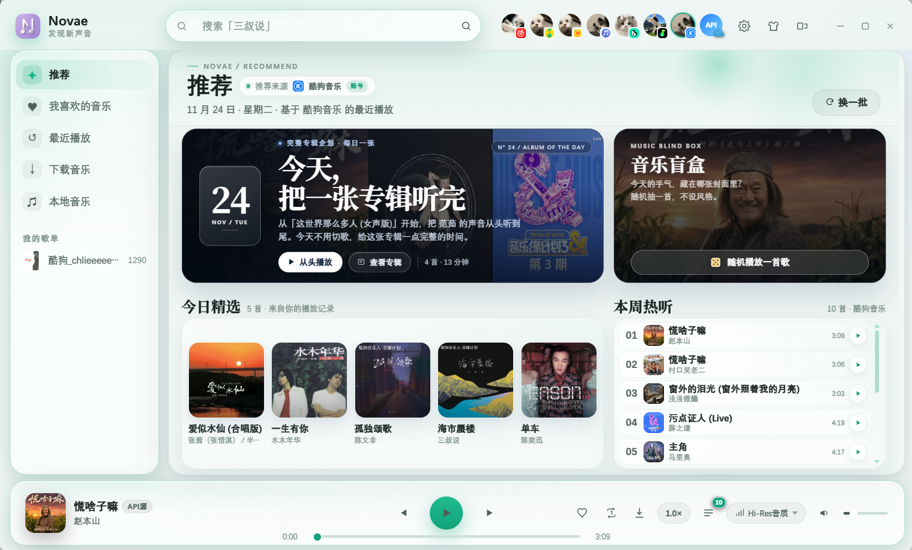
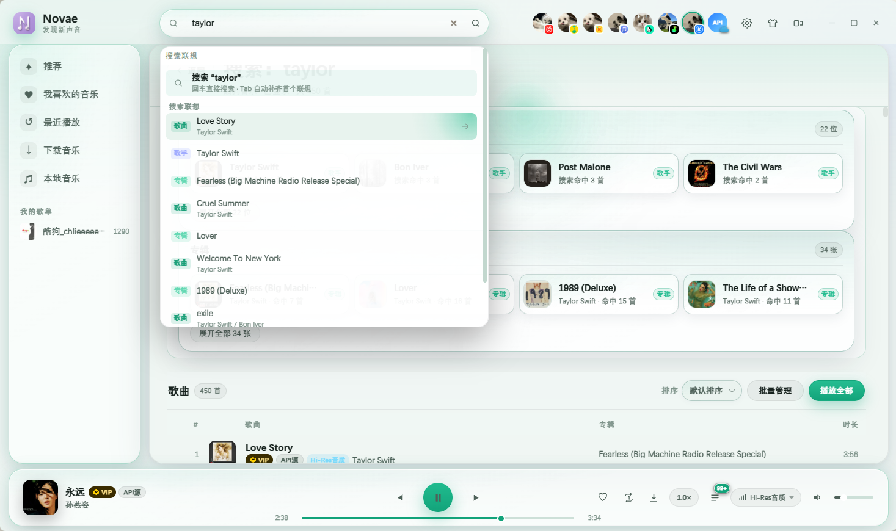
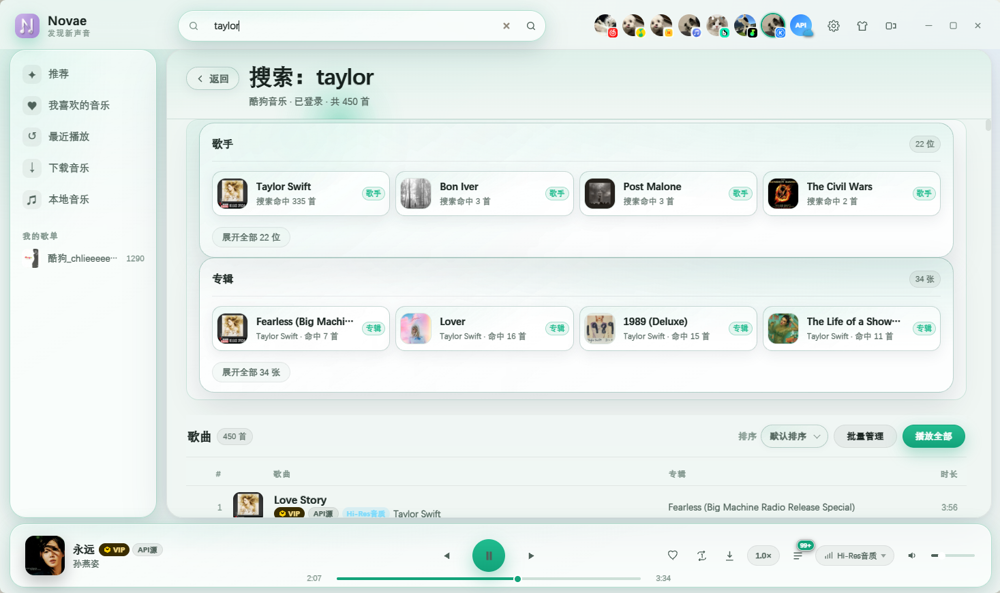
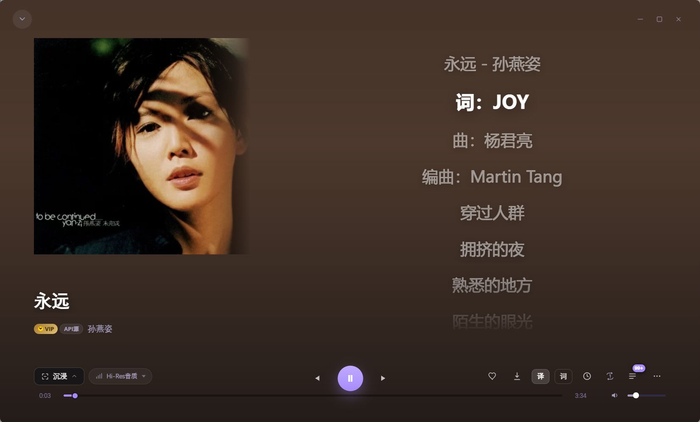
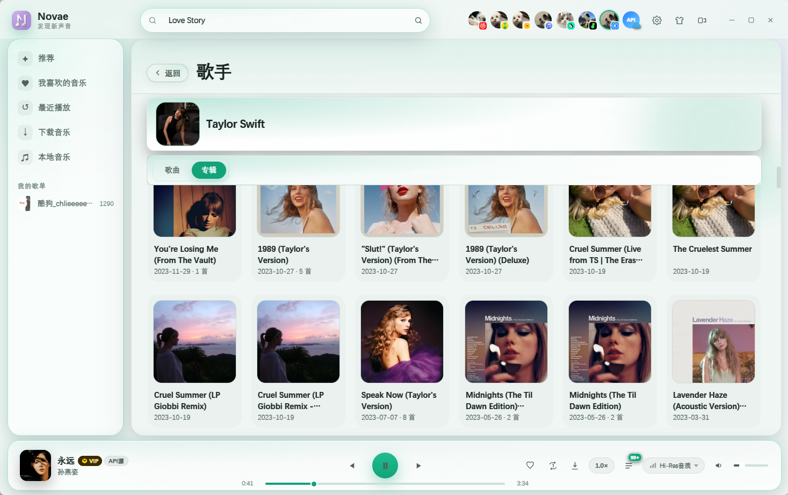

# Novae

**把七个音乐平台，放进同一个 Windows 播放器。**

Novae 是基于 **Wails v2（Go + WebView2）** 构建的桌面音乐客户端。华为音乐、QQ 音乐、网易云音乐、酷狗音乐、酷我音乐、汽水音乐与波点音乐可以同时登录、随时切换；也可以不登录任何平台，只接一个自建或公开的云端音源。

[](https://github.com/TongWang0808/novae-releases/releases/latest)
[](https://github.com/TongWang0808/novae-releases/releases/tag/v1.3.9)
[](LICENSE)

[下载最新版](https://github.com/TongWang0808/novae-releases/releases/latest) · [Gitee 镜像](https://gitee.com/meiliwang0808/novae-releases/releases/latest) · [官网](https://tongwang0808.github.io/novae-releases/) · [更新清单](https://github.com/TongWang0808/novae-releases/blob/main/latest.json)

> 本项目为独立实现，与华为、腾讯、网易、酷狗、酷我、抖音/汽水及其关联公司没有隶属、合作或代理关系。各平台名称、会员名称与相关权利归对应公司所有。Novae 不内置音源、账号或会员凭据，不破解 DRM。

## 1.3.9 更新摘要

这是一个以 **汽水音乐 / 波点音乐原生接入**、**最近播放归属重做** 和 **全缩放界面收口** 为主的大版本。

- **汽水音乐正式接入**：应用内扫码登录、官方二次验证宿主、手机号验证码备用入口；支持账号资料、会员信息、歌单、搜索、歌词、歌手、播放与最近播放。
- **汽水会员整曲链路**：读取本机 SodaM signer 或 `QISHUI_SIGNER_URL` / `QISHUI_SIGNER_TOKEN`，对 PC 端 CENC MP4 解密后本地代理播放；完整流优先于 30 秒试听。
- **波点音乐正式接入**：应用内扫码登录，支持会员到期时间、歌单、搜索、歌词、歌手介绍、喜欢与最近播放。
- **最近播放归属重做**：按实际开播的默认音源归属，预加载、续播、切音质不重复写入；QQ、酷狗、网易云可异步回写官方最近播放。
- **播放队列重做**：取消分页与页码下拉框，完整列表一次展开；当前固定显示 5 行，第 6 首起由右侧滚动条承载，全档缩放按真实行高测量。
- **账号中心与设置收口**：账号详情明确显示“登录入口”；账号页 Hero 与平台卡统一表面参数；设置页接口地址默认完整脱敏，点击眼睛按钮才显示真实地址并允许编辑。
- **全缩放适配**：90% / 100% / 110% / 125% / 150% 五档重新适配；推荐页按逻辑宽度重排，窄档不再出现“孤儿卡”和被裁按钮。

完整说明见 [v1.3.9 Release](https://github.com/TongWang0808/novae-releases/releases/tag/v1.3.9)。

## 界面

<table>
<tr>
<td width="50%"><br><sub>推荐页与音乐盲盒</sub></td>
<td width="50%"><br><sub>七大平台，一个账号中心</sub></td>
</tr>
<tr>
<td><br><sub>同步平台歌单</sub></td>
<td><br><sub>搜索联想与历史搜索</sub></td>
</tr>
<tr>
<td><br><sub>搜索结果，一览无余</sub></td>
<td><br><sub>歌手简介大卡片</sub></td>
</tr>
<tr>
<td><br><sub>你的外观，由你来定</sub></td>
<td><br><sub>大屏播放，沉浸其中</sub></td>
</tr>
<tr>
<td><br><sub>不仅平台，API 也能兜底</sub></td>
<td><br><sub>沉浸光感，按压形变</sub></td>
</tr>
<tr>
<td><br><sub>专辑卡片，尽收眼底</sub></td>
<td><br><sub>反馈 Q 群，集思广益</sub></td>
</tr>
</table>

## 七个平台，一个账号中心

| 平台 | 登录入口 | 主要能力 |
| --- | --- | --- |
| QQ 音乐 | 网页登录 / QQ / 微信 | 账号、歌单、喜欢、最近播放、搜索、播放、歌词 |
| 酷狗音乐 | 扫码 | 账号、歌单、喜欢、最近播放、搜索、播放、歌词 |
| 酷我音乐 | 网页登录 | 账号、喜欢、歌单、搜索、播放、歌词 |
| 网易云音乐 | 扫码 / 手机号 | 账号、歌单、喜欢、搜索、播放、歌词 |
| 华为音乐 | 网页登录 | 账号、歌单、喜欢、搜索、播放、歌词 |
| 汽水音乐 | 扫码（主）/ 手机号验证码（备用） | 账号、会员、歌单、搜索、播放、歌词、歌手、最近播放 |
| 波点音乐 | 扫码 | 账号、会员、歌单、搜索、播放、歌词、歌手、最近播放 |

汽水 / 波点使用内置客户端，不依赖外部音乐 API；登录会话、播放凭据与签名配置只保存在本机。

## 核心能力

- **统一播放**：七个平台共用一个播放器、队列、歌词页、中控栏与音量控制。
- **最近播放归属**：按实际开播的默认音源归属，预加载、续播、切音质不重复；QQ / 酷狗 / 网易云异步回写官方历史。
- **播放队列**：完整列表 + 5 行可视区 + 右侧滚动条；沉浸模式使用 90% `--bg-elevated` 实底。
- **汽水会员整曲**：SodaM signer / `QISHUI_SIGNER` 签名，CENC MP4 解密与本地代理；完整流优先，试听兜底。
- **波点会员**：会员标识与到期时间、官方最近播放读取与回写、歌单 / 喜欢 / 搜索 / 歌词。
- **搜索与推荐**：搜索联想、历史搜索、歌曲 / 歌手 / 专辑三级结果；每日专辑、音乐盲盒、今日精选、本周热听。
- **歌单同步**：平台歌单收藏、加入 / 移出已有歌单、加入前重复检测。
- **云端兜底**：平台取流失败可切云端 API；API 不可用回退平台。
- **外观与缩放**：12 套主题、玻璃表面、沉浸光感、指针光斑、统一按压形变；五档界面缩放全页适配。
- **隐私与安全**：接口地址默认完整脱敏；已配置地址只读，点击眼睛按钮才显示真实地址并允许编辑。
- **下载与更新**：单曲 / 批量下载、音质选择、下载目录、文件缺失闭环；应用内读取双端更新清单。

## 版本日志

### 1.3.9（2026-11-24）

- 新增汽水音乐内置客户端：扫码登录、2046 官方二次验证宿主、手机号验证码备用入口、账号 ID 回读校验。
- 新增汽水会员整曲链路：PC 端 `track_v2` 签名、CENC MP4 解密、本地媒体代理、完整流优先与试听兜底。
- 新增波点音乐内置客户端：扫码登录、账号资料、会员到期、歌单、搜索、歌词、歌手介绍、最近播放。
- 最近播放改为按实际开播的默认音源归属；QQ / 酷狗 / 网易云异步回写官方历史，移除排序控件。
- 播放队列取消分页与下拉框，固定 5 行可视区 + 右侧滚动条；沉浸队列改为 90% 实底。
- 账号详情改为“登录入口”，按平台显示扫码 / 账号 / 授权入口；账号页补齐用途说明与统一 Hero 表面。
- 设置页接口地址默认脱敏并只读，眼睛按钮切换显示与编辑；账号卡接口地址同步脱敏。
- 汽水 / 波点会员字标缩放到 10px 高、32px 宽；账号默认音源卡改半透明玻璃。
- 软件内「设置 → 关于 → 致谢与开源许可」同步到 2026-11-24 / 1.3.9：补入 SodaM、mygo-music-qishui、bowen_music 与 11 个新增 Go 模块，模块清单从 20 个更新为 31 个。
- 全页面 90% / 100% / 110% / 125% / 150% 五档适配；推荐页按逻辑宽度重排。
- 播放接口可用性探测、播放解析回退、最近播放元数据补全、缓存键与歌曲信息整理。

### 1.3.8（2026-11-23）

- 播放队列徽标全档完整，面板贴住中控栏。
- 搜索推荐词点击搜索、点输入框恢复自由输入。
- 推荐页按逻辑宽度五档重排。

### 1.3.7（2026-11-21）

- 统一账号中心与多登录方式面板；补齐汽水 / 波点会员与最近播放。
- 优化多缩放下的账号页、设置页与中控栏排版。

## 下载与校验

- 版本：**1.3.9**（Windows 文件版本 / 产品版本 `1.3.9.0`）
- 安装包：`novae.exe`
- 大小：`53,446,144` 字节
- SHA-256：`58F92812C2423FF9EC904418F28D853B3337C19679A693EDCF7215B059CB7CD2`
- GitHub Releases：<https://github.com/TongWang0808/novae-releases/releases/tag/v1.3.9>
- Gitee Releases：<https://gitee.com/meiliwang0808/novae-releases/releases/tag/v1.3.9>

```text
58F92812C2423FF9EC904418F28D853B3337C19679A693EDCF7215B059CB7CD2  novae.exe
```

## 安装

1. 下载 `novae.exe`。
2. 直接替换旧版 `Novae.exe`，用户数据、登录态、歌单与下载记录保留在原有 WebView2 用户目录。
3. 首次启动如遇 Windows SmartScreen，选择“更多信息 → 仍要运行”。
4. 汽水会员整曲需本机 SodaM signer 或设置 `QISHUI_SIGNER_URL` / `QISHUI_SIGNER_TOKEN`；未配置时自动回退公开流或试听。
5. 高缩放档在“设置 → 外观 → 界面缩放”切换，切换后当前页面立即按新档重排。

## 第三方与许可

Novae 本体采用 MIT License，见 [LICENSE](LICENSE)。内置 sidecar、Go 模块、界面参考与接口参考的完整清单见 [THIRD-PARTY-NOTICES.md](THIRD-PARTY-NOTICES.md)。

- `assets/kugou-api.exe` 来自 KuGouMusicApi（MIT）。
- 汽水登录 / 签名 / 播放链路参考 SodaM、mygo-music-qishui 等公开实现；未随包分发其源码。
- 波点会员与最近播放协议参考 bowen_music 等公开实现；未随包分发其源码。
- 界面与液态材质参考听澜、Melotopia、沐语与 MyGo；仅参考视觉与交互，未复制代码。

## 致谢

感谢所有在公开仓库、Issue、群聊与实测中提供平台协议、接口字段、登录流程和播放链路线索的开发者。

反馈与交流：见应用内“反馈 Q 群”页面。
